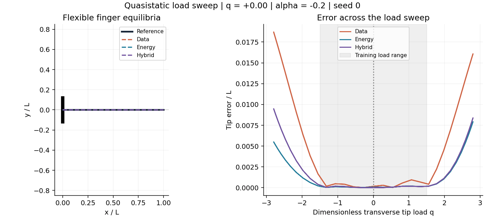
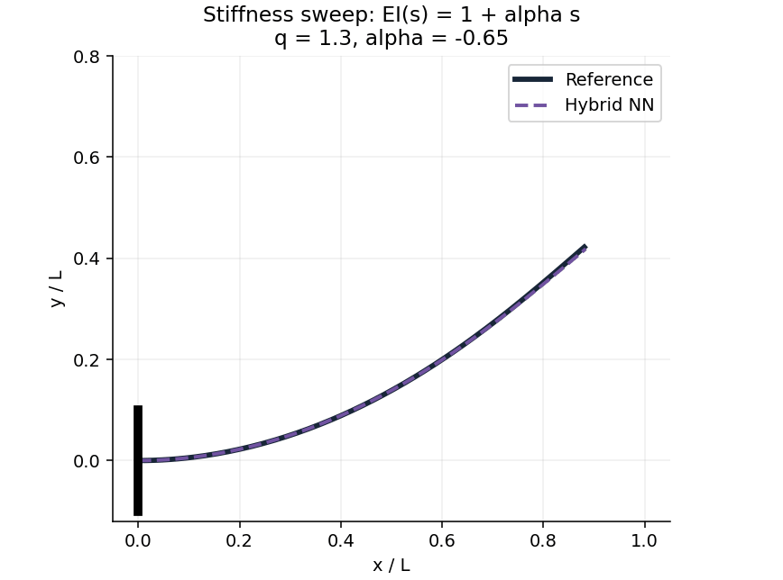

# Physically Constrained Deformation Prediction

**A reproducible nonlinear flexible-finger benchmark: mechanics, neural surrogates, numerical verification, and scientific animations.**



A planar inextensible elastica represents a slender flexible finger. A neural network predicts its large-rotation shape from transverse tip load and a spatial bending-stiffness gradient. Supervised, energy-only, and hybrid training share the same kinematic architecture and are tested under interpolation and parameter extrapolation.

**Scope:** a two-parameter, quasistatic reduced beam model motivated by soft robotics. It is not a full 3D hyperelastic gripper, contact simulation, or experimentally validated robot. The animations show successive equilibria, not dynamics.

## Research question

Does adding a variational mechanical objective improve deformation prediction when labeled equilibria are sparse, and does the benefit persist outside the training parameter range?

The rotation field minimizes

$$\Pi[\theta;q,\alpha]=\frac12\int_0^1(1+\alpha s)(\theta')^2\,ds-q\int_0^1\sin\theta\,ds,$$

with clamp angle $\theta(0)=0$ and zero free-end bending moment. The centerline satisfies $\mathbf r'=(\cos\theta,\sin\theta)$. Dimensionless load is $q=FL^2/B_0$; stiffness is $B(s)=B_0(1+\alpha s)$.

## Results

Mean Euclidean tip error divided by finger length; mean ± sample standard deviation over three initialization seeds, with 80 fixed test cases per split.

| Test split | Supervised | Energy only | Hybrid |
| --- | ---: | ---: | ---: |
| Interpolation | 0.000354 ± 0.000108 | 0.000089 ± 0.000003 | 0.000081 ± 0.000017 |
| Load Extrapolation | 0.005482 ± 0.002136 | 0.002535 ± 0.001356 | 0.002765 ± 0.001112 |
| Stiffness Extrapolation | 0.003106 ± 0.001276 | 0.001003 ± 0.000233 | 0.000915 ± 0.000272 |

The models share hard kinematic constraints. These are comparisons of loss functions within one architecture, not of physics versus entirely unconstrained learning. Energy-only models use 256 unlabeled parameter samples and zero labels; supervised models use 24 labels; hybrid models use both. The conditioning choice was informed by a pilot run. This is a compact computational study, not a blinded hyperparameter benchmark. Raw metrics and optimizer termination records are supplied.


## Report and demonstrations

- [Academic paper (PDF)](report/paper.pdf)
- [Manuscript source (LaTeX)](report/paper.tex)
- [Load-sweep animation](animations/load_sweep.gif): all three methods and reference, with an error panel.
- [Stiffness-sweep animation](animations/stiffness_sweep.gif): hybrid and reference under a changing stiffness gradient.
- [Representative shapes](figures/shapes.png)
- [Numerical convergence](figures/convergence.png)



## Reproduce

Python 3.11 or newer is recommended. No GPU, external dataset, PyTorch, or commercial mechanics software is required. NumPy implements the network and explicit reverse-mode derivatives; SciPy performs optimization and independent BVP validation. Matplotlib and Pillow render the scientific animations. Compiling the academic paper additionally requires a TeX installation with `pdflatex` (e.g., TeX Live). The supplied PDF can be read without TeX.

```bash
python -m venv .venv
source .venv/bin/activate
pip install -r requirements.txt
# For the exact package versions used here: pip install -r requirements-lock.txt
export OPENBLAS_NUM_THREADS=1
python -m unittest discover -s tests -v
python validate_reference.py
python run_experiments.py
python make_visuals.py
python report/build_report.py
python predict.py --load 2.5 --taper -0.2 --method hybrid --output prediction.csv
```

The full benchmark regenerates synthetic labels, three test sets, nine trained models, metrics, logs, and the convergence study. It may take several minutes depending on the CPU and BLAS implementation. Saved weights allow prediction and visual generation without retraining. Re-running `run_experiments.py` replaces generated results and models. Floating-point differences across environments can affect optimizer termination and results.

## Numerical checks

Five automated tests cover the mechanical energy gradient, selected neural-network derivatives, the analytical small-load limit, load-sign symmetry/zero loading, and arclength reconstruction. A separate adaptive continuous BVP solver checks three nonlinear cases; maximum angle disagreement with the 256-segment reference is below 2.5e-6 radians. A 16–512 segment refinement study is included for one high-load case. These checks support the examined regime rather than certify all possible loads or branches.

## Repository map

| Path | Contents |
| --- | --- |
| `src/mechanics.py` | Discrete variational elastica, reference solver, centerline reconstruction |
| `src/network.py` | Shared tanh network, explicit gradients, three training objectives |
| `run_experiments.py` | Fixed-seed data generation, training, evaluation, mesh refinement |
| `validate_reference.py` | Independent continuous BVP checks |
| `predict.py` | Saved-model inference to CSV |
| `make_visuals.py` | Figures and two scientific GIF animations |
| `report/` | Academic manuscript PDF, LaTeX source, data-generated tables, and build script |
| `models/` | Nine saved NumPy weight files |
| `results/` | Data, metrics, optimizer histories, validation, environment metadata |
| `tests/` | Numerical verification tests |

## Limitations and next steps

The study excludes extension, shear, pressure actuation, contact, inertia, material hysteresis, and 3D effects. The transverse load is conservative and fixed in direction. Reference optimization follows one low-energy equilibrium branch; global minimality and all other branches are not established. The spectral representation has 12 modes and quadrature uses 64 segments. Test results use one dataset seed and three initialization seeds. No general speedup claim is made.

Next steps are label-count and loss-weight studies, independent dataset repetitions, mode/quadrature refinement, and a verified 2D hyperelastic finite-element extension before pressure actuation or contact.

## References

1. E, W. and Yu, B. *The Deep Ritz method: A deep learning-based numerical algorithm for solving variational problems.* [arXiv:1710.00211](https://arxiv.org/abs/1710.00211), 2017.
2. Nguyen-Thanh, V. M., Zhuang, X., and Rabczuk, T. *A deep energy method for finite deformation hyperelasticity.* European Journal of Mechanics – A/Solids 80, 103874, 2020. [DOI](https://doi.org/10.1016/j.euromechsol.2019.103874).

**Author:** Jiajun Fu, Duke Kunshan University. Developed with AI assistance for code, analysis, and writing. The paper presents a computational study of an idealized flexible finger. Existing repository license is retained in [LICENSE](LICENSE).
