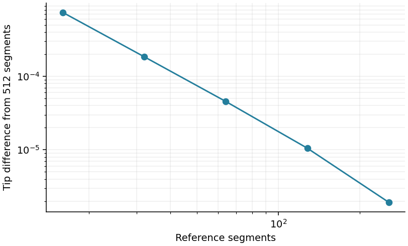
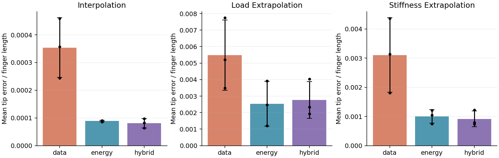
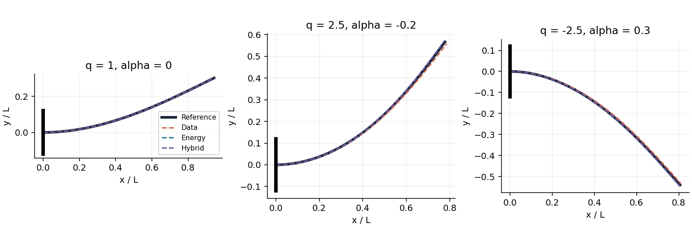
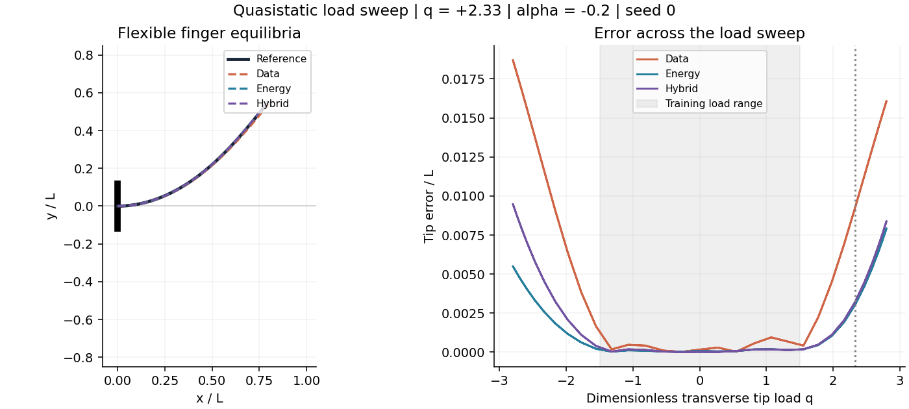

# Physically Constrained Deformation Prediction for a Planar Flexible Finger

<b>Jiajun Fu</b><br/>Duke Kunshan University<br/>Computational research report | October 2026

## Abstract

This study tests whether variational physics constraints improve neural prediction of large-rotation deformation in a flexible-finger benchmark. A planar, inextensible Euler elastica with spatially varying bending stiffness is subjected to a conservative transverse tip load. Three parametric neural surrogates share the same architecture and kinematic representation: supervised, energy-only, and hybrid. Training uses 24 labeled equilibria and, where applicable, 256 unlabeled parameter samples. Evaluation uses 80 held-out cases per split and three initialization seeds. Reference solutions are checked against a continuous boundary-value solver, a small-load analytical solution, and mesh refinement. The energy-only model achieves a mean extrapolation tip error of 0.00254 finger lengths versus 0.00548 for supervised learning across initialization seeds. Reported results also quantify interpolation and stiffness extrapolation. Physics-informed training is evaluated empirically rather than presumed superior. The deliverable is a reproducible numerical benchmark, not experimental validation of a robotic gripper.

## 1. Research question and scope

Can minimum-potential-energy training improve deformation prediction under sparse supervision, and does any benefit persist outside the training parameter domain? The target is a load-to-shape map for a flexible cantilever motivated by soft robotic fingers. This model captures finite rotations and nonlinear load response while retaining a simple, independently verifiable mechanics problem.

The body is a slender planar rod with negligible extension and shear. There is no contact, pressure chamber, viscoelasticity, inertia, or three-dimensional deformation. Accordingly, this study supports conclusions about reduced-order elastic fingers only. It does not establish performance for a fabricated pneumatic gripper.

The variational-learning premise follows the Deep Ritz method [1] and the deep energy approach to mechanics [2]. The present work implements a small parametric neural coefficient map and a transparent benchmark protocol; it does not claim to introduce energy-based neural mechanics.

## 2. Mechanics and variational formulation

Let S denote physical arclength, L the finger length, B0 a reference bending stiffness, F the transverse tip force, and s = S/L. Define q = FL^2/B0 and B(s)/B0 = 1 + alpha s. Positive stiffness requires alpha &gt; -1. The rotation field theta(s) determines the dimensionless centerline r(s).

```text
r'(s) = (cos(theta(s)), sin(theta(s)))
r(0) = (0,0), theta(0) = 0
Pi[theta;q,alpha] = (1/2) integral_0^1 (1+alpha*s) theta'(s)^2 ds
                    - q integral_0^1 sin(theta(s)) ds
```

The first term is bending energy divided by B0/L; the second is the potential of a dead load fixed in the laboratory transverse direction. The nonlinear trigonometric kinematics distinguish this model from small-deflection beam theory. A follower force would produce a different problem and is not used.

```text
delta Pi = integral_0^1 [(1+alpha*s) theta' eta' - q cos(theta) eta] ds
((1+alpha*s) theta')' + q cos(theta) = 0
theta(0) = 0, ((1+alpha*s) theta')(1) = 0
```

The test variation eta vanishes at the clamp. Integration by parts yields the nonlinear equilibrium equation and the natural zero-moment condition at the free end. Introducing m = (1 + alpha s)theta-prime gives the independent first-order BVP: theta-prime = m/(1 + alpha s), m-prime = -q cos(theta), with theta(0) = 0 and m(1) = 0.

For constant stiffness and sufficiently small q, sin(theta) is approximately theta in the energy and cos(theta) is approximately one in equilibrium. Therefore theta(s) = q(s - s^2/2) to leading order; the tip deflection is approximately q/3. This supplies an analytical verification case.

## 2.1 Discrete reference

```text
Pi_h = sum_i B_(i-1/2) (theta_i-theta_(i-1))^2/(2h)
       - q sum_i w_i sin(theta_i), theta_0 = 0
```

The reference minimizes this discrete potential with midpoint stiffness, trapezoidal centerline weights, and 256 segments. L-BFGS-B starts from the small-load rotation profile. This computes a low-energy equilibrium branch; no exhaustive search over all stationary branches or global-minimum proof is attempted.

## 3. Neural surrogates and experiment design

```text
theta_NN(s;q,alpha) = sum_(k=0)^11 c_k(q,alpha) phi_k(s)
phi_k(s) = sin((k+1/2)*pi*s)/(2k+1)^2
```

A tanh network maps normalized inputs (q/1.5, alpha/0.4) through two hidden layers of 24 units to 12 coefficients. The representation satisfies theta(0) = 0 and theta-prime(1) = 0 analytically. Centerlines reconstructed from rotations are inextensible in the continuum; trapezoidal reconstruction introduces a small quadrature error. The frequency scaling moderates optimization conditioning. All three methods use these same kinematic constraints, so the comparison isolates loss choices rather than comparing constrained versus entirely unconstrained kinematics.

```text
L_data = mean_(labeled cases,nodes) |theta_NN - theta_ref|^2
L_energy = mean_(unlabeled parameters) Pi_64[theta_NN]
L_hybrid = L_energy + 0.1 L_data
```

Potential energy can be negative; its absolute magnitude is not an error metric. Energy-only training requires no reference labels, although labeled cases are retained in the common dataset for the other methods. Physics losses are computed at 64 segments. The coefficient map is a finite-dimensional parametric neural surrogate, not a discretization-invariant neural operator.

| Item | Specification |
| --- | --- |
| Labeled training cases | 24; uniform q in [-1.5,1.5], alpha in [-0.4,0.4] |
| Unlabeled physics cases | 256; independent draws from the same rectangle |
| Interpolation test | 80 independent cases in the training rectangle |
| Load extrapolation test | 80 cases; |q| in [1.5,3], alpha in [-0.4,0.4] |
| Stiffness extrapolation test | 80 cases; q in [-1.5,1.5], |alpha| in [0.4,0.65] |
| Repetitions | Initialization seeds 0, 1, 2; dataset seed 20261016 |
| Optimizer | L-BFGS-B; at most 1,800 iterations per model |

Labels and test references are generated separately. Test references are never included in the training loss. Hyperparameters were chosen for this compact demonstration; an initial conditioning check informed the frequency scaling and iteration budget. There is no claim of a blinded model-selection study or an exhaustive hyperparameter search.

## 4. Numerical verification

The continuous BVP cross-check uses adaptive collocation at tolerance 1e-9 for (q, alpha) = (1,0), (3,-0.4), and (-2,0.6). The maximum nodal rotation difference from the 256-segment reference is 2.413e-06 radians. These independent checks support the reference on the examined cases, without proving accuracy everywhere in the parameter domain.

Five automated tests verify the discrete energy gradient by finite differences, neural reverse-mode derivatives on selected weights, the small-load rotation formula, load-sign symmetry and zero loading, and reconstructed arclength. The separate validate_reference.py script reproduces the continuous BVP comparisons.



The 256-to-512 segment tip difference is 1.928e-06 finger lengths at this refinement case. Both the reference and neural centerlines are evaluated with their own quadrature grids. Consequently, reported prediction errors include representation, optimization, generalization, and small discretization differences.

## 4.1 Evaluation measures

```text
tip error = ||r_NN(1) - r_ref(1)||_2
angle relative L2 = ||Theta_NN - Theta_ref||_F / ||Theta_ref||_F
centerline RMSE = sqrt(mean((R_NN - R_ref)^2))
```

The CSV also records discrete energy gaps and the RMS of the energy gradient multiplied by 64. This stationarity diagnostic depends on the chosen discretization and includes endpoint effects; it is not reported as a continuum residual norm. Cross-seed standard deviations describe initialization variability on one fixed dataset, not population confidence intervals.

## 5. Results

| Test split | Supervised | Energy only | Hybrid |
| --- | --- | --- | --- |
| Interpolation | 0.00035 +/- 0.00011 | 0.00009 +/- 0.00000 | 0.00008 +/- 0.00002 |
| Load Extrapolation | 0.00548 +/- 0.00214 | 0.00254 +/- 0.00136 | 0.00277 +/- 0.00111 |
| Stiffness Extrapolation | 0.00311 +/- 0.00128 | 0.00100 +/- 0.00023 | 0.00092 +/- 0.00027 |

Table 1. Mean tip error divided by finger length, averaged across three initialization seeds; +/- denotes sample standard deviation. Each seed uses the same 80 test cases per split. Lower is better.



For interpolation, the lowest mean tip error is obtained by the hybrid model (0.00008 L). This ranking applies to the specified architecture, dataset, training budget, and test distribution.

For load extrapolation, the lowest mean tip error is obtained by the energy model (0.00254 L). This ranking applies to the specified architecture, dataset, training budget, and test distribution.

For stiffness extrapolation, the lowest mean tip error is obtained by the hybrid model (0.00092 L). This ranking applies to the specified architecture, dataset, training budget, and test distribution.

Optimizer termination is recorded for every model: 6 of 9 runs satisfy the solver termination criteria; other runs stop at the iteration budget or another recorded condition. These outcomes are part of the benchmark, and an optimizer convergence flag alone does not establish physical correctness. Full histories, gradient norms, timings, and solver messages are included in results/training.json.

## 6. Deformation fields and scientific animations





The load-sweep GIF evaluates equilibria along q = 2.8 sin(tau) at alpha = -0.2 and displays all methods against the reference. Tau is a visualization phase, not physical time. The stiffness-sweep GIF varies alpha from -0.65 to 0.65 at q = 1.3, comparing the hybrid model with the reference. The line trajectories are generated from numerical solutions and saved neural weights; they are not generative illustrations.

These animations show bending kinematics and distribution shift. They do not simulate dynamics, actuation pressure, collision, grasp success, or physical sensor measurements. The unscaled centerline axes permit direct geometric comparison.

## 7. Discussion and limitations

The experiment separates hard kinematic structure from variational training: every neural model satisfies the same clamp and analytical free-end moment constraints, while only two losses use mechanical energy. Therefore a supervised advantage would not show that physics is useless; it would show that this additional energy objective is not sufficient to outperform an already structured surrogate under the tested conditions. Conversely, an energy-model advantage would not establish general superiority across geometries or constitutive laws.

Several mechanisms can affect performance. Spectral truncation limits local curvature representation. The discrete bending term weights short-wavelength rotation errors strongly, creating conditioning challenges. A finite set of unlabeled parameter samples constrains the learned map inside the sampled domain but does not enforce equilibrium at every unseen parameter. Hybrid behavior also depends on the fixed data-loss coefficient. A broader study should examine label-count curves, independent dataset seeds, loss-weight sensitivity, mode counts, physics quadrature resolution, and more optimizer budgets.

The present scope is deliberately limited to one two-parameter rod family. Material behavior is represented through bending stiffness, not a learned three-dimensional hyperelastic constitutive law. Only a few continuous BVP checks and one mesh-refinement case are supplied. No uncertainty calibration, experimental validation, comprehensive speedup study, contact mechanics, or stability-branch classification is claimed.

## 8. Conclusion and next research steps

This benchmark finds lower mean tip errors for energy-based training than supervised training on all three fixed test splits. The hybrid model has the lowest mean interpolation and stiffness-extrapolation errors, while the energy-only model has the lowest mean load-extrapolation error. These findings are conditional on the present model and protocol. The project combines nonlinear mechanics, structured neural prediction, numerical verification, and scientific animations. Its contribution is an inspectable computational study and an honest comparison of learning objectives. A natural next step is a two-dimensional hyperelastic finger with finite-element reference solutions, followed by pressure actuation and contact. Those extensions require new mechanics verification and should be evaluated as separate studies.

## References

[1] E, W., and Yu, B. The Deep Ritz method: A deep learning-based numerical algorithm for solving variational problems. arXiv:1710.00211 (2017). https://doi.org/10.48550/arXiv.1710.00211

[2] Nguyen-Thanh, V. M., Zhuang, X., and Rabczuk, T. A deep energy method for finite deformation hyperelasticity. European Journal of Mechanics - A/Solids 80, 103874 (2020). https://doi.org/10.1016/j.euromechsol.2019.103874

<b>Reproducibility and assistance.</b> All data are synthetic and generated by the supplied solvers. The repository includes source, saved models, raw metrics, environment metadata, and build scripts. Code, analysis, and report drafting were developed with AI assistance. This document is an unreviewed computational project report; it is not a peer-reviewed publication.
